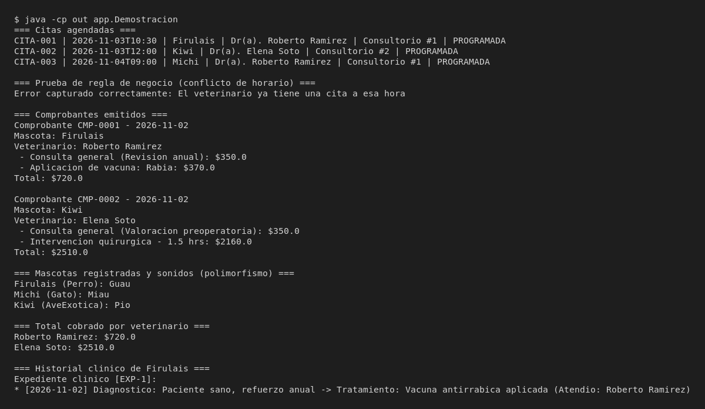

# PetCare

Programa de consola en Java para administrar la operación diaria de la clínica veterinaria PetCare. Permite registrar dueños y mascotas, dar de alta veterinarios, agendar citas verificando disponibilidad de horarios y consultorios, atender consultas médicas asociando servicios cobrables y emitir comprobantes con el desglose de costos. Toda la información se conserva en memoria mediante colecciones mientras el programa está en ejecución.

## Tabla de contenido

1. [Tecnologías](#tecnologías)
2. [Modelo de la solución](#modelo-de-la-solución)
3. [Estructura del proyecto](#estructura-del-proyecto)
4. [Conceptos aplicados](#conceptos-aplicados)
5. [Reglas de negocio](#reglas-de-negocio)
6. [Instalación y ejecución](#instalación-y-ejecución)
7. [Ejemplo de uso](#ejemplo-de-uso)
8. [Reflexión](#reflexión)
9. [Autor](#autor)

## Tecnologías

- **Lenguaje:** Java 21 (OpenJDK 21)
- **Modelado UML:** Mermaid (`docs/diagramas/clases.mmd`) exportado a PNG
- **Entorno de desarrollo:** Consola en Linux y compilación directa con `javac`

## Modelo de la solución

El análisis detallado de clases candidatas, objetos de ejemplo y justificación de relaciones se encuentra en [docs/analisis.md](docs/analisis.md).


### Decisiones de diseño

- **Herencia y clases abstractas:** Se definieron dos jerarquías independientes. `Persona` concentra nombre, apellido, teléfono y correo para `Dueno`, `Veterinario` y `Recepcionista`. Por su parte, `Mascota` agrupa los datos del paciente y declara el método abstracto `emitirSonido()`, que cada subclase (`Perro`, `Gato`, `AveExotica`) implementa según su especie.
- **Interfaz `ServicioCobrar`:** Los servicios médicos (`ConsultaGeneral`, `Vacunacion`, `Cirugia`) comparten la obligación de calcular su importe y devolver una descripción, pero no tienen estado común. Una interfaz resuelve ese contrato sin forzar una herencia artificial.
- **Ventaja del polimorfismo:** Tanto al recorrer `List<Mascota>` para invocar `emitirSonido()` como al sumar `List<ServicioCobrar>` dentro de `Comprobante.calcularTotal()`, el código opera sobre el supertipo sin usar `instanceof` ni condicionales por tipo. Si mañana se agrega un nuevo servicio (por ejemplo, radiografía) o una nueva especie, ni `Comprobante` ni `Clinica` necesitan modificarse.
- **Composición vs. agregación:**
  - **Composición:** `Clinica` instancia internamente sus objetos `Consultorio` a partir del número de sala, y `Mascota` crea su propio `HistorialClinico` al nacer y lo anula (`historial = null`) en `darDeBaja()` para que el recolector de basura reclame esa memoria junto con sus `Consulta`.
  - **Agregación:** Los objetos `Veterinario` y `Recepcionista` se crean fuera de `Clinica` y se incorporan con `contratarVeterinario()` o `contratarRecepcionista()`. Si la clínica desaparece, el personal sigue existiendo como entidad independiente.

## Estructura del proyecto

```text
petcare-poo-java/
├── README.md
├── .gitignore
├── docs/
│   ├── analisis.md
│   ├── diagramas/
│   │   ├── clases.mmd
│   │   └── clases.png
│   └── capturas/
│       ├── escenario.png
│       └── escenario.txt
└── src/
    ├── app/
    │   ├── Main.java
    │   ├── Menu.java
    │   ├── Entrada.java
    │   └── Demostracion.java
    └── modelo/
        ├── personas/
        │   ├── Persona.java
        │   ├── Dueno.java
        │   ├── Veterinario.java
        │   └── Recepcionista.java
        ├── mascotas/
        │   ├── Mascota.java
        │   ├── Perro.java
        │   ├── Gato.java
        │   ├── AveExotica.java
        │   ├── HistorialClinico.java
        │   └── Consulta.java
        ├── servicios/
        │   ├── ServicioCobrar.java
        │   ├── ConsultaGeneral.java
        │   ├── Vacunacion.java
        │   └── Cirugia.java
        └── clinica/
            ├── Clinica.java
            ├── Consultorio.java
            ├── Cita.java
            ├── EstadoCita.java
            └── Comprobante.java
```

- `app`: Punto de entrada interactivo (`Main`, `Menu`, `Entrada`) y escenario reproducible (`Demostracion`).
- `modelo.personas`: Jerarquía de personas vinculadas a la clínica (clientes y personal).
- `modelo.mascotas`: Jerarquía de pacientes animales, su expediente médico y las consultas registradas.
- `modelo.servicios`: Interfaz de cobro y clases de servicios veterinarios con sus fórmulas de precio.
- `modelo.clinica`: Coordinación de citas, consultorios, validaciones de agenda y emisión de comprobantes.

## Conceptos aplicados

| Concepto | Archivo | Líneas | Aplicación en el proyecto |
|---|---|---|---|
| Clase abstracta y método abstracto | `src/modelo/mascotas/Mascota.java` | 5, 23 | `Mascota` es abstracta y declara `emitirSonido()` sin cuerpo. |
| Segunda jerarquía de herencia | `src/modelo/personas/Persona.java` | 3-48 | `Persona` (abstracta) heredada por `Dueno`, `Veterinario` y `Recepcionista`. |
| Uso de `super(...)` | `src/modelo/mascotas/Perro.java` | 10-14 | El constructor de la subclase inicializa los atributos heredados de `Mascota`. |
| Sobrecarga de constructores | `src/modelo/servicios/ConsultaGeneral.java` | 8-22 | Tres constructores con distintas firmas (por defecto, completo y solo motivo). |
| Sobrecarga de métodos | `src/modelo/clinica/Clinica.java` | 117-135 | `buscarMascota(String)` y `buscarMascota(Dueno)`. |
| Sobreescritura (`@Override`) | `src/modelo/mascotas/Perro.java`, `src/modelo/clinica/Cita.java` | 20-23, 66-70 | Implementación de `emitirSonido()` y redefinición de `toString()`. |
| Interfaz | `src/modelo/servicios/ServicioCobrar.java` | 3-7 | Define `calcularCosto()` y `getDescripcion()` para tres servicios concretos. |
| Polimorfismo con interfaz | `src/modelo/clinica/Comprobante.java` | 28-34 | `calcularTotal()` recorre `List<ServicioCobrar>` sin `instanceof`. |
| Polimorfismo con herencia | `src/app/Menu.java` | 217-226 | `listarMascotasYSonidos()` recorre `List<Mascota>` invocando `emitirSonido()`. |
| Composición | `src/modelo/mascotas/Mascota.java`, `src/modelo/clinica/Clinica.java` | 17-18, 32-34 | Creación interna de `HistorialClinico` en `Mascota` y de `Consultorio` en `Clinica`. |
| Eliminación de objetos | `src/modelo/mascotas/Mascota.java`, `src/app/Menu.java` | 59-61, 246-259 | `darDeBaja()` rompe la referencia al historial y `Menu` retira la mascota de la lista. |
| Agregación | `src/modelo/clinica/Clinica.java` | 36-42 | `contratarVeterinario()` y `contratarRecepcionista()` reciben objetos externos. |
| Asociación | `src/modelo/clinica/Cita.java` | 12-23 | Relaciona `Mascota`, `Veterinario` y `Consultorio` existentes en una fecha y hora. |
| Atributo `static` | `src/modelo/clinica/Comprobante.java` | 12, 21 | `contadorFolios` genera folios consecutivos (`CMP-0001`, `CMP-0002`). |

## Reglas de negocio

1. **Edad y peso mayores a cero:** Se validan en `Mascota.setEdad()` (`src/modelo/mascotas/Mascota.java`, líneas 25-30) y `Mascota.setPeso()` (líneas 32-37), lanzando `IllegalArgumentException`.
2. **Sin citas duplicadas para el mismo veterinario:** `Clinica.agendarCita()` invoca `veterinarioOcupado()` (`src/modelo/clinica/Clinica.java`, líneas 60-62 y 99-106) e impide agendar si el médico ya tiene una cita no cancelada en esa misma fecha y hora.
3. **Consultorio sin traslapes:** `Clinica.agendarCita()` verifica `consultorioOcupado()` (`src/modelo/clinica/Clinica.java`, líneas 56-58 y 90-97) antes de crear la cita.
4. **Cita cancelada no atendible:** `Cita.marcarComoAtendida()` (`src/modelo/clinica/Cita.java`, líneas 25-33) lanza `IllegalStateException` si el estado actual es `CANCELADA` o si ya fue atendida.
5. **Costos no negativos:** Los constructores de `ConsultaGeneral` (`líneas 13-15`), `Vacunacion` (`líneas 10-12`) y `Cirugia` (`líneas 10-12`) rechazan tarifas, duraciones o factores menores a cero.
6. **Consulta de cobros por mascota y por veterinario:** Implementada en `Clinica.consultarCobrosPorMascota()` y `Clinica.consultarCobrosPorVeterinario()` (`src/modelo/clinica/Clinica.java`, líneas 70-88).

## Instalación y ejecución

Clonar el repositorio y compilar desde la raíz del proyecto:

```bash
git clone https://github.com/JesusMGH-UV/petcare-poo-java.git
cd petcare-poo-java
javac -d out $(find src -name '*.java')
```

Para iniciar el menú interactivo de consola:

```bash
java -cp out app.Main
```

Para correr directamente el escenario de demostración obligatorio:

```bash
java -cp out app.Demostracion
```

## Ejemplo de uso

Salida al ejecutar `java -cp out app.Demostracion`:



```text
=== Citas agendadas ===
CITA-001 | 2026-11-03T10:30 | Firulais | Dr(a). Roberto Ramirez | Consultorio #1 | PROGRAMADA
CITA-002 | 2026-11-03T12:00 | Kiwi | Dr(a). Elena Soto | Consultorio #2 | PROGRAMADA
CITA-003 | 2026-11-04T09:00 | Michi | Dr(a). Roberto Ramirez | Consultorio #1 | PROGRAMADA

=== Prueba de regla de negocio (conflicto de horario) ===
Error capturado correctamente: El veterinario ya tiene una cita a esa hora

=== Comprobantes emitidos ===
Comprobante CMP-0001 - 2026-11-02
Mascota: Firulais
Veterinario: Roberto Ramirez
 - Consulta general (Revision anual): $350.0
 - Aplicacion de vacuna: Rabia: $370.0
Total: $720.0

Comprobante CMP-0002 - 2026-11-02
Mascota: Kiwi
Veterinario: Elena Soto
 - Consulta general (Valoracion preoperatoria): $350.0
 - Intervencion quirurgica - 1.5 hrs: $2160.0
Total: $2510.0

=== Mascotas registradas y sonidos (polimorfismo) ===
Firulais (Perro): Guau
Michi (Gato): Miau
Kiwi (AveExotica): Pio

=== Total cobrado por veterinario ===
Roberto Ramirez: $720.0
Elena Soto: $2510.0

=== Historial clinico de Firulais ===
Expediente clinico [EXP-1]:
* [2026-11-02] Diagnostico: Paciente sano, refuerzo anual -> Tratamiento: Vacuna antirrabica aplicada (Atendio: Roberto Ramirez)
```

## Reflexión

Armar el diagrama de clases antes de programar ayudó bastante a no mezclar responsabilidades entre `Cita`, `Consulta` y `Comprobante`. Al principio parecía más rápido meter el cálculo de precios directo en `Cita`, pero separar la interfaz `ServicioCobrar` dejó el código mucho más limpio cuando tocó combinar distintos cargos en una misma visita.

Lo más laborioso fue cuidar el ciclo de vida en las relaciones de composición y validar las entradas del usuario en consola sin que un dato mal escrito rompiera la ejecución con un `NumberFormatException`. Si tuviera más tiempo, agregaría persistencia en archivos JSON o CSV para no perder los registros al cerrar el menú y añadiría pruebas unitarias con JUnit para las reglas de agenda.

## Autor

- **Jesús** - [@JesusMGH-UV](https://github.com/JesusMGH-UV)
